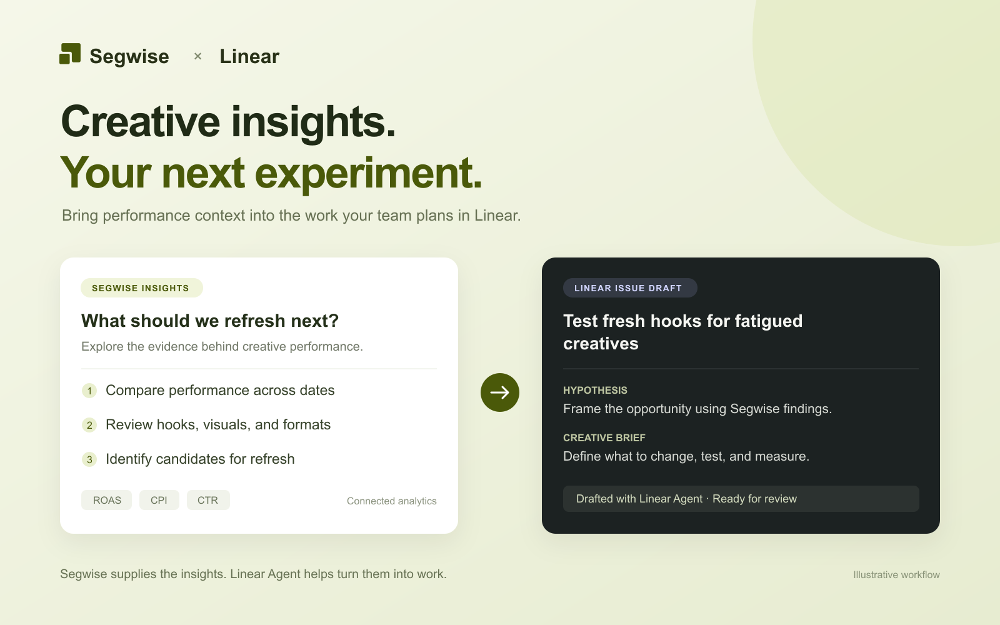

# Segwise assets for the Linear Integration Directory

Public listing artwork. These assets contain no customer data or authentication credentials.

| Asset | Dimensions | PNG | SVG |
| --- | --- | --- | --- |
| Segwise color icon | 320 × 320 | [Download PNG](segwise-color-320.png?raw=true) | [Download SVG](segwise-color-320.svg?raw=true) |
| Segwise white monochrome icon | 320 × 320 | [Download PNG](segwise-white-320.png?raw=true) | [Download SVG](segwise-white-320.svg?raw=true) |
| Workflow showcase | 1600 × 1000 | [Download PNG](segwise-linear-showcase-1600x1000.png?raw=true) | [Download SVG](segwise-linear-showcase-1600x1000.svg?raw=true) |

The icon backgrounds are transparent. The white icon is intended for a dark background.

## Showcase caption

Use Segwise creative-performance insights to draft your next experiment with Linear Agent.

The showcase is a designed workflow illustration, not a screenshot of customer data or the Linear interface.

[Integration setup guide](../../linear.md)
